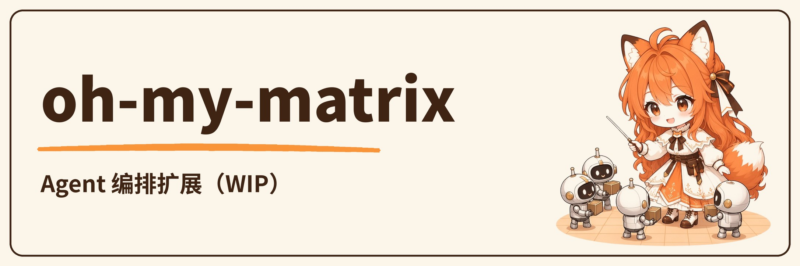

<!-- markdownlint-disable MD013 MD033 MD041 -->

我是阿舟，在「阿舟的 Agent 实验室」做三件事：Agent Skills、本地 AI、人控自动化。能跑只是起点；边界、证据、可复现性和人的最终判断，同样属于交付。

<!-- STATS-START -->

<!-- STATS-END -->

## 从这里开始：经得起验证的 Agent Skills

每个 skill 都当产品做：触发明确、拿来就能跑、验收确定、证据留档，演化路径由人拍板。v1.0.0 已于 2026-10-23 发布。

[打开 Azhou AI Hub →](https://github.com/TeFuirnever/azhou-ai-hub) · [看 Release →](https://github.com/TeFuirnever/azhou-ai-hub/releases)

## 实验台上：还在孵化

为中文优化的本地语音输入。 [打开 Murmur →](https://github.com/TeFuirnever/Murmur) · [项目主页 →](https://tefuirnever.github.io/Murmur/)

Agent 编排扩展，还在 WIP。 [打开 oh-my-matrix →](https://github.com/TeFuirnever/oh-my-matrix) · [项目主页 →](https://tefuirnever.github.io/oh-my-matrix/)

## 边做边学：三本橙皮书

[Matt Pocock Skills 橙皮书 →](https://github.com/TeFuirnever/matt-pocock-skills-orange-book) · [Claude Code Internals 橙皮书 →](https://github.com/TeFuirnever/claude-code-internals-orange-book) · [DeepSeek Harness 橙皮书 →](https://github.com/TeFuirnever/deepseek-harness-orange-book)

## 我怎么判断「做完了」

**REAL BEHAVIOR** 代码、配置和可复现结果，比陈旧文字更可靠。 
**HUMAN JUDGMENT** AI 生成不稀缺；知道该做什么、该停在哪里才稀缺。 
**HONEST HOLD** 本地通过不等于生产就绪；外部与人工验收未完成就保持 HOLD。 
**CONTROL** 自动化负责执行，人负责授权、升级与最终发布。

## 开源足迹

GitHub Actions 每天重绘这两张卡：一年贡献热力图，和一张 Neofetch 风格的系统快照。数据直连 GitHub GraphQL，数字没变就不产生提交。

## 直接抄作业

这两张卡、五枚徽章和每日自动刷新由仓库里三个脚本驱动：[fetch_stats.py](scripts/fetch_stats.py) · [count_loc.py](scripts/count_loc.py) · [render_profile.py](scripts/render_profile.py)

图文教程见 [content/github-profile-readme-guide.md](content/github-profile-readme-guide.md)，fork 改用户名即用。

[更多开源项目 →](https://github.com/TeFuirnever?tab=repositories)
