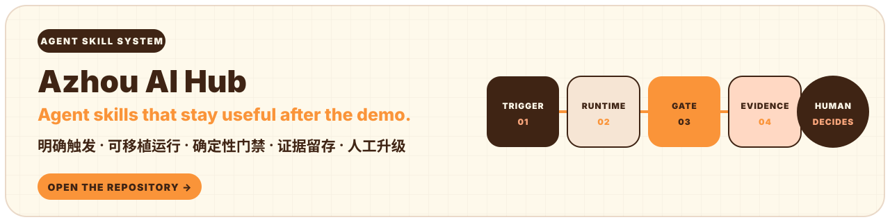
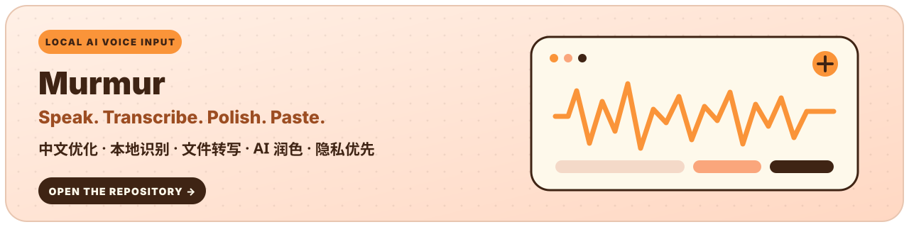
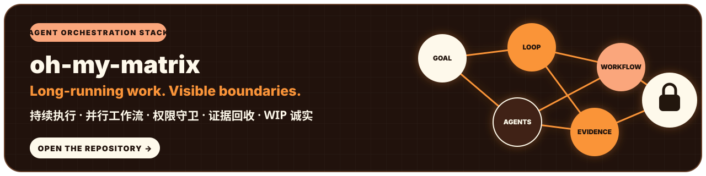
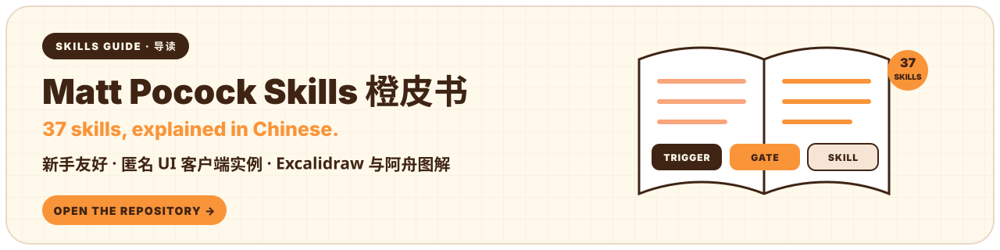
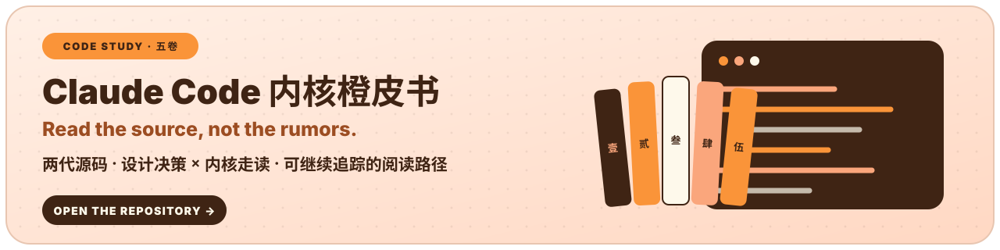
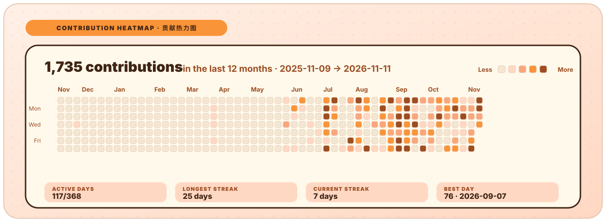
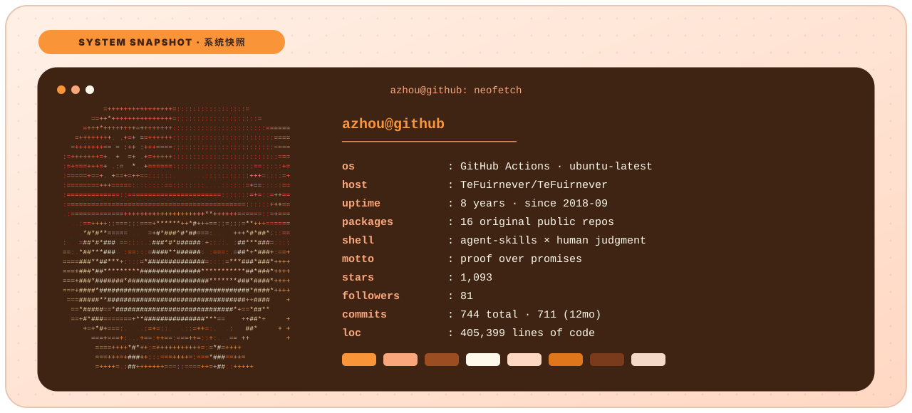

# 阿舟 · Azhou

<!-- markdownlint-disable MD013 MD033 -->

  

<strong>阿舟的 Agent 实验室 · Agent Skills · Local AI · Human-Controlled Automation</strong>

我不做只在演示里好看的 AI 项目。能跑只是起点；边界、证据、可复现性和人的最终判断，同样属于交付。

<!-- STATS-START -->

<!-- STATS-END -->

<!-- markdownlint-enable MD013 MD033 -->

---

## AZHOU / 阿舟

阿舟是这个账号面向开源的实验室品牌。我用同一套实践标准做三件事：Agent Skills、本地 AI、人控自动化。

每一次公开交付都回答四个问题：**能不能运行？别人能不能复现？自动化边界是否清楚？什么时候交还给人？**

---

## NOW BUILDING / 正在构建

### [Azhou AI Hub](https://github.com/TeFuirnever/azhou-ai-hub) · 经得起验证的 Agent Skills

每个 skill 都当产品做：触发明确、拿来就能跑、验收确定、证据留档，演化路径由人拍板。

### [Murmur](https://github.com/TeFuirnever/Murmur) · 为中文优化的本地 AI 语音输入

说话就能打字，也能批量转写音频，再用 AI 整理成可继续编辑的文本；语音识别在本地完成。

### [oh-my-matrix](https://github.com/TeFuirnever/oh-my-matrix) · OpenClaw-native Agent 编排扩展

让长程任务持续执行，把复杂工作拆成可验证的并行流程，并在真实工具调用前守住权限边界。当前仍是 WIP。

---

## ORANGE BOOKS / 橙皮书

### [Matt Pocock Skills Orange Book](https://github.com/TeFuirnever/matt-pocock-skills-orange-book) · AI 协作开发的 Skills 中文导读

面向 AI 协作开发新手，整理 37 个 Skills、匿名 UI 客户端实例、Excalidraw 与阿舟图解。

### [Claude Code Internals Orange Book](https://github.com/TeFuirnever/claude-code-internals-orange-book) · Claude Code 内核走读

用五卷内容拆解 Claude Code 的设计决策与关键内部机制，给出可继续追踪的源码阅读路径。

### [DeepSeek Harness Orange Book](https://github.com/TeFuirnever/deepseek-harness-orange-book) · 全插件 Agent 内核走读

四卷套装：实战指南 × 源码走读 × mini-harness × 演进与评价，对着 pinned 源码树读懂全插件 Agent 内核。

---

## PROOF OVER PROMISES / 证据优先

| SIGNAL | OPERATING RULE |
| --- | --- |
| `REAL BEHAVIOR` | 代码、配置和可复现结果，比陈旧文字更可靠。 |
| `HUMAN JUDGMENT` | AI 生成不稀缺；知道该做什么、该停在哪里才稀缺。 |
| `HONEST HOLD` | 本地通过不等于生产就绪；外部与人工验收未完成就保持 HOLD。 |
| `CONTROL` | 自动化负责执行，人负责授权、升级与最终发布。 |

---

## OPEN-SOURCE TRACK / 开源足迹

GitHub Actions 每天重绘这两张卡：一年贡献热力图，和一张 Neofetch 风格的系统快照。数据直连 GitHub GraphQL，数字没变就不产生提交。

**主要阵地** · [GitHub](https://github.com/TeFuirnever)
· [Azhou AI Hub](https://github.com/TeFuirnever/azhou-ai-hub)

**正在维护** · [Murmur](https://tefuirnever.github.io/Murmur/)
· [oh-my-matrix](https://tefuirnever.github.io/oh-my-matrix/)

**直接抄作业** · 这两张卡、五枚徽章和每日自动刷新由仓库里三个脚本驱动：
[fetch_stats.py](scripts/fetch_stats.py) · [count_loc.py](scripts/count_loc.py) · [render_profile.py](scripts/render_profile.py)
图文教程见 [content/github-profile-readme-guide.md](content/github-profile-readme-guide.md)，fork 改用户名即用。
